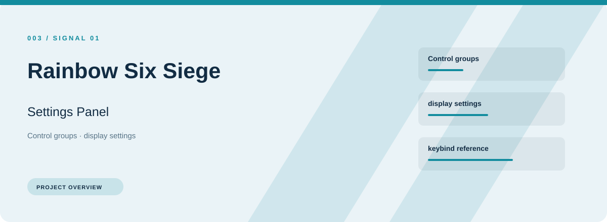
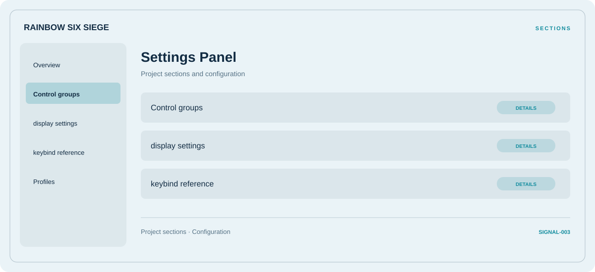

# 🧭 Rainbow Six Siege Settings Panel

**Control groups · Display settings · Keybind reference**

## ⚡ Features

Rainbow Six Siege Settings Panel focuses on three connected areas: control groups, display settings, keybind reference. Its organization keeps frequently used options close to the context they belong to.

### ⚙️ Control groups

A dedicated section for control groups and the configuration details associated with that area.

### 🧩 Display settings

Display or performance-related options, with space for configuration and comparison information.

### ⌨️ Keybind reference

Shortcut assignments and control mappings, organized in one reference section.

## 🖥️ Project navigation

## 📥 Download

The button and cover open the project's download page. Use the information supplied with the downloaded package for installation and release-specific requirements.

## 📚 Project documentation

- [Feature reference](docs/FEATURES.md)
- [Download information](docs/DOWNLOAD.md)
- [Project page](index.html)

---

Rainbow Six Siege Settings Panel · Program documentation and download information.
